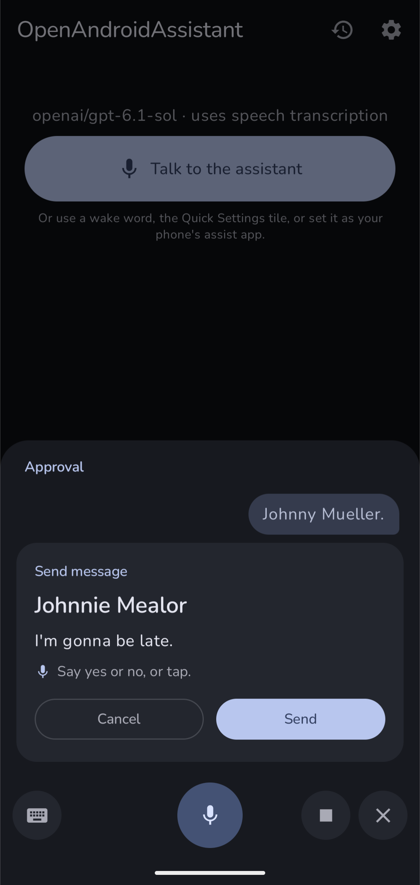

<li type="none">
<h1>OpenAndroidAssistant</h1>
</li>

- 🤩 A (private) AI voice assistant for Android that actually does stuff
- 🤯 Three modes: speech-to-text into any model, native audio in (the model hears you directly), or full realtime voice with GPT-Live
- 🤓 Runs fully on your phone with local models (Gemma, Qwen, Granite), or use any OpenRouter/OpenAI model
- 😱 Texts, calls, calendar, alarms, timers, weather, directions, music, web search, and a lot more
- 🫡 Every tool runs right away or asks first, your call
- 🥶 (Custom) wake words through [LibreWakeWord](https://github.com/w1b/LibreWakeWord)
- 🫠 Currently alpha, so settings and data might not survive updates

 
